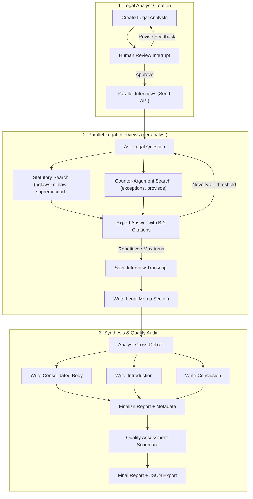

# 🏛️ BD Legal Research Assistant — LangGraph Multi-Agent System

A production-grade multi-agent **Bangladesh legal research assistant** built with **LangGraph** that generates specialist legal analyst personas, conducts parallel web-search interviews across official Bangladesh law sources, enables adversarial analyst debate, and produces structured legal research memos with verified statutory citations.

> **Attribution**: Multi-agent research architecture inspired by the [LangChain Academy](https://academy.langchain.com/) research pattern, extensively specialized for Bangladesh legal research with statutory citation verification, adversarial analyst debate, security guardrails, cost tracking callbacks, and comprehensive graph execution tests.

---

## ✨ Features

- **BD Legal Domain Specialization** — Analyst personas specialized in Constitutional, Corporate, Criminal, Labour, Land, Family, Tax, Banking, Environmental, and Cyber law of Bangladesh.
- **Official Legal Sources** — Focused queries on official portals including `bdlaws.minlaw.gov.bd`, `supremecourt.gov.bd`, and `lawjusticediv.gov.bd`.
- **Parallel Legal & Counter-Argument Search** — Simultaneously queries for supporting statutory provisions and opposing perspectives, provisos, amendments, and exceptions.
- **Adversarial Analyst Debate** — Analysts cross-critique each other's draft memos to uncover statutory contradictions, regulatory gaps, and outdated laws.
- **Adaptive Interview Depth** — LLM-assessed novelty scoring terminates repetitive interviews early while preserving deep coverage of novel provisions.
- **Citation Grounding & Cross-Check** — Automated citation density scoring and source cross-verification flags disputed claims without misleading guarantees.
- **Security & Privacy Guardrails** — Input sanitization drops prompt injections, and localized PII detectors mask Bangladeshi mobile numbers and NIDs.
- **Non-Destructive Quality Assessment** — Audits clarity, completeness, coherence, and citation quality with structured scorecards (no auto-rewriting).
- **Callback-Based Cost Tracking** — `BaseCallbackHandler` tracks token usage across structured and plain LLM calls, computing estimated costs with dynamic model pricing.
- **Interactive CLI & Multi-Format Export** — Run research sessions via terminal with human review, exporting to Markdown and structured JSON.

---

## 🏗️ Architecture



| Graph | Entry Point | Description |
|---|---|---|
| `create_analysts` | `src/agent.py:graph` | Generates legal analyst personas with human review |
| `answer_question` | `src/answering_questions.py:question_answer_graph` | Single analyst legal interview with web search |
| `deep_agent` | `src/deep_agent.py:graph` | Full pipeline — analysts → interviews → debate → memos → critique |

---

## 📚 BD Legal Data Sources

The search queries are optimized to prioritize these official Bangladesh legal sources:

| Source | Portal | Content |
|---|---|---|
| **BDLaws (Official)** | `bdlaws.minlaw.gov.bd` | All Acts, Ordinances, President's Orders, and Rules |
| **Supreme Court** | `supremecourt.gov.bd` | Appellate & High Court Division judgments and cause lists |
| **Law & Justice Division** | `lawjusticediv.gov.bd` | Gazettes, legal reforms, and administrative orders |
| **Bangladesh Bar Council** | `barcouncil.gov.bd` | Legal practice canons and professional conduct rules |
| **The Daily Star (Law)** | `thedailystar.net/law-our-rights` | Legal commentary, human rights, and judicial analysis |

---

## 🚀 Quick Start

### 1. Clone & Install

```bash
git clone https://github.com/shahin5646/Research-Assistant-Langgraph.git
cd Research-Assistant-Langgraph
uv sync
```

### 2. Configure Environment

```bash
cp .env.example .env
# Edit .env and supply your API keys:
#   OPENAI_API_KEY=sk-... (or INMETECH_API_KEY=imt-...)
#   TAVILY_API_KEY=tvly-...
```

### 3. Run via CLI

```bash
uv run python main.py --topic "Can a foreign company set up a 100% owned subsidiary in Bangladesh?"
```

### 4. Run with LangGraph Studio

```bash
uv run langgraph dev
```

Open LangGraph Studio and select the `deep_agent` graph.

### 5. Run Test Suite

```bash
uv run pytest tests/ -v
```

---

## ⚙️ Configuration

Controlled via environment variables defined in [`.env.example`](.env.example):

| Variable | Default | Description |
|---|---|---|
| `OPENAI_API_KEY` | *optional* | OpenAI API key |
| `INMETECH_API_KEY` | *optional* | Inmetech gateway API key |
| `OPENAI_BASE_URL` | *auto* | Custom gateway URL (defaults to Inmetech if Inmetech key set, else OpenAI) |
| `TAVILY_API_KEY` | *required* | Tavily web search API key |
| `LLM_MODEL` | `gpt-4o-mini` | Default model (supports gpt-4o, gpt-4o-mini, gpt-4.1-nano) |
| `LLM_TEMPERATURE` | `0` | Model temperature |
| `LLM_TIMEOUT` | `60` | Request timeout in seconds |
| `DEFAULT_MAX_TURNS` | `2` | Ceiling for interview question-and-answer turns |
| `TAVILY_MAX_RESULTS` | `3` | Max web results retrieved per search query |
| `NOVELTY_THRESHOLD` | `0.3` | Score threshold for early termination of repetitive interviews |
| `ENABLE_DEBATE` | `true` | Toggle analyst cross-critique step (saves ~30% calls when disabled) |
| `ENABLE_SCORING` | `true` | Toggle section source grounding assessment |
| `ENABLE_VERIFICATION` | `true` | Toggle claim cross-checking against search results |
| `ENABLE_CRITIQUE` | `true` | Toggle final quality assessment scorecard |

---

## 🔒 Security & Privacy

Built-in multi-stage security pipeline designed for sensitive legal inquiries:

- **Prompt Injection Defense** — Blocks common jailbreaks (`DAN`, `system prompt reveal`) and drops compromised search results.
- **Bangladesh PII Masking** — Automatically detects and masks Bangladeshi mobile formats (`+880 1712 345678`, `01712-345678`), emails, context-aware NIDs, and credit cards.
- **Output Exploit Redaction** — Detects leaked secrets or harmful exploit attempts and redacts them in-place without wiping out legitimate legal analysis.

---

## 📁 Project Structure

```text
├── main.py                      # Interactive CLI runner with checkpointer
├── pyproject.toml               # Project metadata & dependencies
├── langgraph.json               # LangGraph server configuration
├── .env.example                 # Environment template with recommended defaults
├── scripts/
│   └── build_release_zip.sh     # Clean archive generator excluding secrets and caches
├── src/
│   ├── agent.py                 # Legal analyst creation graph
│   ├── answering_questions.py   # Subgraph: legal interview with web search
│   ├── deep_agent.py            # Main pipeline: creation → interviews → debate → memos → audit
│   └── utils/
│       ├── cost_tracker.py      # LangChain callback metrics & dynamic pricing table
│       ├── debate.py            # Adversarial analyst cross-critique & consensus
│       ├── edges.py             # Conditional routing & collision-free state mapping
│       ├── export.py            # Structured JSON & Markdown export builders
│       ├── models.py            # LLM instantiation with single-point get_llm() accessor
│       ├── nodes.py             # All graph nodes with transient retry predicates
│       ├── objects.py           # Pydantic models (Analyst, Perspectives)
│       ├── prompts.py           # Bangladesh law prompt templates & untrusted fences
│       ├── scoring.py           # Citation density & source grounding metrics
│       ├── security.py          # Injection detection, BD PII masking, exploit redactor
│       ├── states.py            # TypedDict definitions with interview_turns isolation
│       └── verification.py      # Claim cross-checking against search results
└── tests/
    ├── conftest.py              # Shared fixtures
    ├── test_cost_export.py      # Cost tracking, reset, and export tests
    ├── test_debate.py           # Adversarial debate logic tests
    ├── test_edges.py            # Edge routing & turn ceiling tests
    ├── test_graphs.py           # Graph compilation smoke tests
    ├── test_graph_execution.py  # Full deep_agent execution integration tests
    ├── test_nodes.py            # Node function tests (formatting, caps, headers)
    ├── test_objects.py          # Pydantic model validation tests
    ├── test_scoring.py          # Grounding score & badge tests
    ├── test_security.py         # Prompt injection, BD PII, and false-positive tests
    └── test_verification.py    # Source cross-check marker tests
```

---

## 🧪 Testing

The comprehensive test suite runs without live API keys:

```bash
uv run pytest tests/ -v
```

All unit and integration tests run deterministically against mock LLMs and search engines, validating state transitions, pause/resume behavior, and error handling.

---

## 📝 License

MIT
